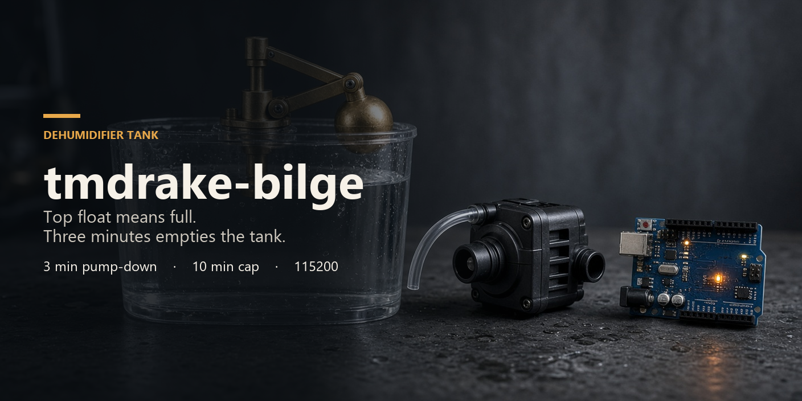

<p align="center">
  
</p>

# tmdrake-bilge

Pump timer for a dehumidifier tank. The float switch is on the top of the tank. It closes when the water reaches the top. It cannot see empty.

Open the serial monitor at **115200** baud and press `?` for the menu.

## Code

`TMDRAKE_Timer.ino` is `setup` and `loop`. The rest of the sketch is split by job.

| File | What it holds |
| --- | --- |
| `bilge.h` | Pins, the 3 minute and 10 minute limits, and the shared names |
| `pump.cpp` | Float debounce and the pump states |
| `odometer.cpp` | Run count, runtime, and the EEPROM record |
| `screen.cpp` | Live diagnostic screen and the one-key menu |
| `bilge_state.cpp` | The variables those files share |

## Timeouts

Both limits are `unsigned long` milliseconds in `bilge.h`.

| Constant | Default | What it does |
| --- | --- | --- |
| `EMPTY_RUNON_MS` | 3 minutes | After the float drops, the motor keeps running and empties the water below the switch. Then it turns off and the sketch calls the tank empty. That call is still a guess. There is no bottom sensor. |
| `MAX_RUN_MS` | 10 minutes | One continuous run, including the 3 minute pump-down, cannot last longer than this. Ten minutes is past a normal empty, so the cap does not cut that pump-down short. |

A float stuck up, or a pump that never pulls the level off the top, latches the motor off (`FAULT`). The latch holds while the float stays up, because a stuck switch never makes a new edge. A later rise, meaning the float went down and then came back, starts a new cycle. Leaving the float down for a full pump-down interval also clears the latch back to idle.

The 10 minute clock does not restart if the float bounces back up while the pump is already running. `MAX_RUN_MS` has to stay longer than a normal pump-down plus `EMPTY_RUNON_MS`.

## Serial menu

One letter, no enter. The live screen pauses while the menu is open so the text stays put. The pump logic keeps running.

| Key | Action |
| --- | --- |
| `?` | Menu. `h` and `m` do the same. |
| `o` | How many times the motor has run, total run time, this run, and the last run. |
| `s` | Live diagnostic screen. |

`runs` counts each time the motor turns on. `odo` / `total run` is the sum of those runs. Both are stored in EEPROM and survive power loss. The count is saved when the motor turns on. The added time is saved when it turns off, so a run that is still going when power dies is counted, but its unfinished minutes are not. Empty-guess and fault counts are still cleared by a reset. The total wraps after 49.7 days of motor-on time, not 49.7 days of wall clock. Writes happen only on those motor changes, and only the bytes that changed are written.

The same `runs` and `odo` lines are on the live screen.

## How far the timer fired

The screen times each empty guess against its deadline.

- `+N ms LATE` means the pump turned off after the deadline. That should be a few milliseconds, not a line of serial delay.
- `float back` / `EARLY` means the float reached the top again before the 3 minute pump-down finished. The tank was not empty. The millisecond figure is how early the float cancelled the guess.
- `max-run cap` means the 10 minute limit won. The motor is latched off.

`refill` is how long the float stayed down after an empty guess, until water reached the top again. A refill of a few seconds means the pump stopped while the tank was still high. `since guess` counts that wait live.

`at top` is how long the float stayed up while the pump ran. A long time there means the pump is not pulling the level off the top switch.

The empty-timer average uses the last 16 empty guesses only. Float-back and max-run trips are counted beside it and are not mixed into the average.

Uptime comes from `millis()` and wraps at about 49.7 days. Empty-guess and fault counts wrap at 65535. The run counter and the odometer are wider and wrap much later.

## Wiring

| Signal | Pin | Notes |
| --- | --- | --- |
| Top float | 2 | Active HIGH when the tank is full. Add a pulldown to ground so a loose wire reads LOW. |
| Pump | 13 | The onboard LED follows the pump. Use a relay or MOSFET. Do not hang the motor on the pin. |

Pin 13 stays the output so existing LED wiring still works. An Uno has no internal pulldown, and a pullup would fight this active-HIGH float.

## Timer wrap

`millis()` wraps every 2^32 milliseconds (about 49.7 days). The old sketch stored `timerEnd = now + duration` and treated the timer as running while `now < timerEnd`. When the float dropped in the last 3 minutes before that wrap, `timerEnd` became a small number, the comparison failed, and the pump turned off immediately.

Timers now store a start time, a duration, and an armed flag. A timer is due when `(now - start) >= duration`. Unsigned subtraction stays valid across the wrap. Zero is not used as a sentinel.

The loop does not call `delay()`. The float is debounced for 50 ms without blocking. The screen is sent only as fast as the serial buffer can take it, so a print cannot hold the pump past a deadline.

## Screen

One block on state change, and about once a second. The sketch does not print a line on every pass.

```
====== tmdrake-bilge ======
top float, HIGH = full
up 00:14  (wraps 49.7d)
runs 4  odo 12:06
empties 3  faults 0
state EMPTY-RUNON
float DOWN  below top
motor ON
at top 00:42
empty 02:18 / 03:00
max   08:36 / 10:00
------ last fire ------
empty guess +2 ms LATE
at top 00:40  ran 03:40
------ empty timer ------
last +2 ms ON TIME
avg +4 ms ON TIME
min -1  max +18  n=3
float-back 1  max-run 0
refill 18:12
since guess --
? menu   o odometer   s live
```

`ON TIME` is an error of 0 ms. Any positive error is `LATE`. Any negative error is `EARLY`.
